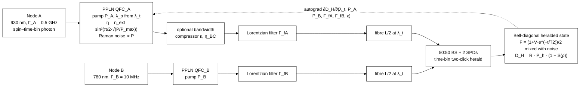
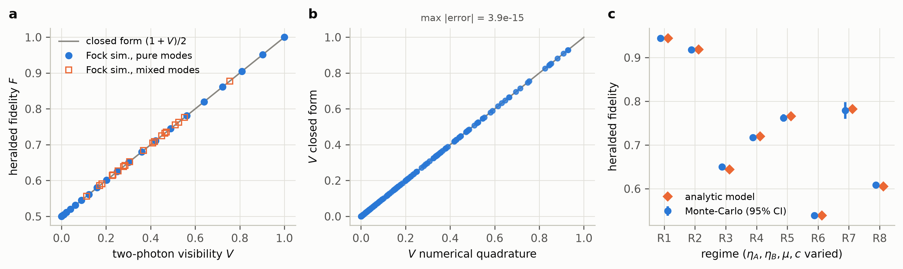
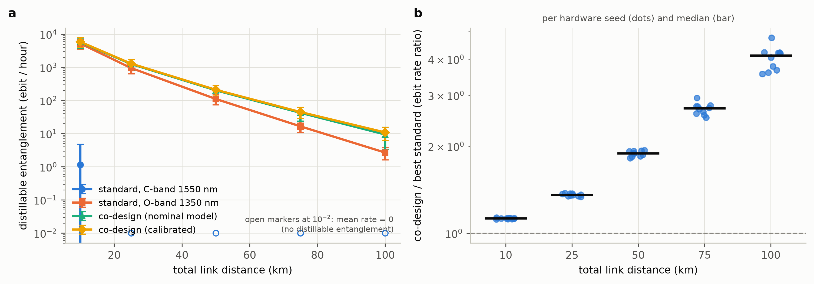
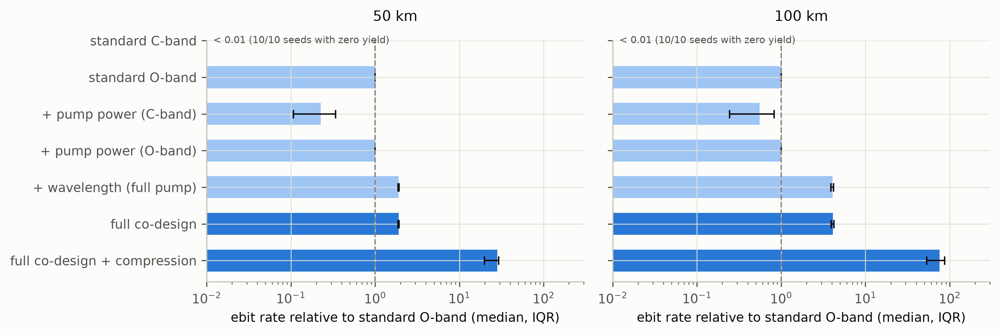
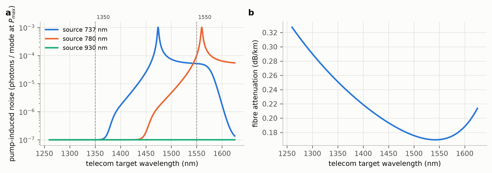
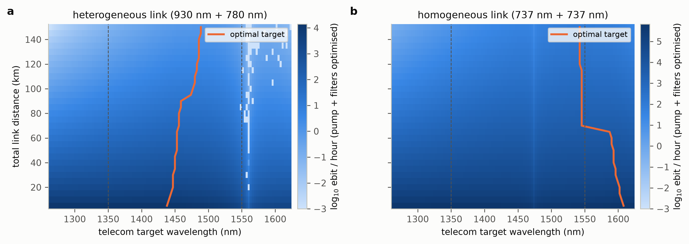
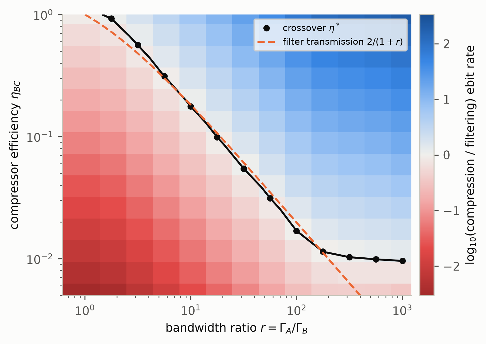
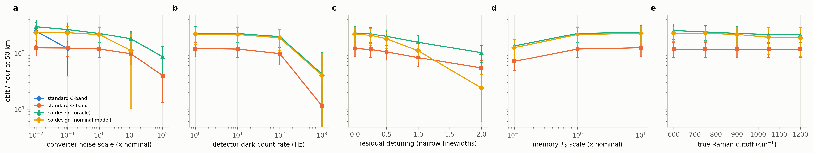
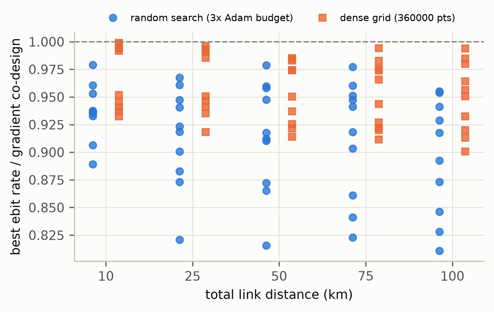

# Noise-aware co-design of frequency and bandwidth conversion for heterogeneous quantum-network links

[](LICENSE)
[](https://www.python.org/downloads/release/python-3119/)
[](https://github.com/pradeepdegalaroyal/qfc-codesign-heterogeneous-quantum-links/actions/workflows/ci.yml)

**Abstract.** Linking two *different* quantum memories by photon interference requires
converting both photons to one telecom wavelength and matching their bandwidths. Each choice
trades conversion efficiency, pump-induced noise, fibre loss and indistinguishability against
the others. We build a validated, differentiable model of a heralded two-node link with periodically poled lithium niobate (PPLN)
quantum frequency conversion. We then co-optimise the telecom target wavelength, both pump
powers and both filter bandwidths for a 930 nm broadband emitter linked to a 780 nm narrowband
memory. In simulation over 10 randomised hardware instances with 10 % calibration error,
co-design raises the hashing-bound distillable-entanglement rate by a median **4.1×** (+312 %) at
100 km over the better of two literature-style operating points (Wilcoxon p = 0.002). The
gain comes almost entirely from choosing a target near 1440–1470 nm instead of the O- or
C-band.

> Scope: this is a **simulation study**. Hardware parameters are representative,
> order-of-magnitude assumptions. They are randomised and swept, and the noise model is
> phenomenological. Nothing here is an experimental demonstration.

---

## Motivation

A practical quantum network has to connect *heterogeneous* nodes: quantum-dot or colour-centre
emitters, atomic or ionic memories, and new solid-state defects. These nodes emit at
different visible/near-infrared (NIR) wavelengths and with linewidths from MHz to GHz. Two-node entanglement
over deployed fibre has already been shown with bidirectional quantum frequency conversion (QFC) of identical silicon-vacancy (SiV) nodes to
1350 nm (Knaut et al., 2024). Moving from identical to heterogeneous nodes, and from tens of
km to ~100 km, makes one engineering question central for any conversion roadmap:

*Which target wavelength, pump power and bandwidth-matching strategy should each converter
use, and how much does a wrong choice cost?*

## Research gap (details: [docs/RESEARCH_GAP.md](docs/RESEARCH_GAP.md))

- Quantum repeaters and networks must beat **loss and noise** in the channel
  (Azuma et al., 2023, doi:10.1103/RevModPhys.95.045006). Record quantum key distribution (QKD) reaches its distance
  mainly by **noise suppression** (≈0.02 Hz system noise for 1002 km twin-field quantum key distribution (TF-QKD); Liu et al., 2023,
  doi:10.1103/PhysRevLett.130.210801).
- Lithium niobate gives χ(2) conversion across the spectrum (Boes et al., 2023,
  doi:10.1126/science.abj4396). QFC to telecom enabled memory–memory entanglement over a 35 km
  deployed loop (Knaut et al., 2024, doi:10.1038/s41586-024-07252-z), but with **identical** nodes.
- Heterogeneous platforms differ in wavelength and linewidth: spin qubits (Burkard et al., 2023,
  doi:10.1103/RevModPhys.95.025003), waveguide-QED emitters (Sheremet et al., 2023,
  doi:10.1103/RevModPhys.95.015002), trapped ions (Moses et al., 2023,
  doi:10.1103/PhysRevX.13.041052) and silicon carbide (SiC) colour centres (Zhao et al., 2027, doi:10.1063/5.0326538).
  Network-native integration of such resources remains open (Mouaji & Al-Kuwari, 2027,
  doi:10.1016/j.cosrev.2026.101047).
- **Gap:** we found no end-to-end, noise-aware treatment that *jointly* chooses target
  wavelength, pump powers and filter bandwidths for a heterogeneous pair. None scores the
  choice with a fidelity-aware entanglement metric, tests it under calibration error, or maps
  when active bandwidth compression beats filtering.

**Pre-registered hypotheses.** H1: ≥ 10 % median gain at 100 km over the best standard, with
p < 0.05. H2: nominal-model co-design wins on ≥ 8/10 seeds at 50 and 100 km. H3: the
compression-vs-filtering crossover η*(r) lies within a factor 2 of 2/(1+r) for every r ≥ 10.

## Method (details: [docs/METHOD.md](docs/METHOD.md))



*Diagram abbreviations: BS = beam splitter; SPDs = single-photon detectors.*

- **Physics** (`src/qfclink/physics.py`, `link.py`):
  - A closed-form Hong-Ou-Mandel (HOM) visibility of two Lorentzian-filtered, detuned photons, derived by
    contour integration so that it has no removable singularities.
  - Difference-frequency generation (DFG) pump wavelength fixed by λ_t, with Raman-type pump noise per spectral-temporal mode.
    Noise is weighted by the Bose–Einstein occupation on the anti-Stokes or Stokes side and
    rolls off above a phonon cutoff.
  - Empirical fibre loss, a gated-detector noise model and memory dephasing during the
    herald wait.
  - Rate: hashing-bound distillable entanglement.
- **Validation:**
  - Fock-space simulation of the Bell-state measurement (BSM) with bosonic symmetrisation for pure and mixed spectral
    states (`fock.py`).
  - Numerical quadrature of the overlap integral.
  - Event-level Monte Carlo of the heralding logic (`montecarlo.py`).
- **Strategies:**
  - `std_C` / `std_O`: λ_t = 1550 nm or 1350 nm, full pump, filters *tuned by the same
    optimiser*. These are the strong literature-style baselines.
  - Ablations: pump-only, wavelength-only.
  - `codesign`: all five variables.
  - `codesign + compression`.
- **Classical (design-procedure) baselines:** derivative-free random search with 3× the
  evaluation budget, and a 360,000-point dense grid, against multi-start Adam through the
  differentiable model.
- **Realism.** Each of 10 seeds draws a "true" device: noise ×log-normal(σ = 0.5), Raman cutoff
  ±30 cm⁻¹, efficiencies ±20 %, linewidths, dephasing time (T2), detuning. The operating point is designed on
  the **nominal model**, on a **calibrated** estimate (10 % error), or on the true device
  (**oracle**), and is always **evaluated on the true device**.
- **Statistics:** paired two-sided Wilcoxon signed-rank test on per-seed log-ratios, with
  percentile-bootstrap 95 % continuous integration (CI) of the median gain.

## Results

All numbers are from `results/` (full run, 10 seeds, mean ± std across seeds).

### Model validation (`results/validation_*.csv`, Fig. 1)

| Check | Result |
|---|---|
| Fock-space BSM vs F = (1+V)/2 (21 pure + 20 mixed cases) | max \|ΔF\| = 3.3 × 10⁻¹⁶; herald probability 0.5 in every case |
| Closed-form vs quadrature visibility (200 random draws, 1 MHz – 20 GHz) | max \|ΔV\| = 3.9 × 10⁻¹⁵ |
| Event Monte Carlo (2 × 10⁶ attempts × 8 regimes) vs analytic | max \|z\| = 2.03 (herald prob.), 1.99 (fidelity) |



### Main comparison: heterogeneous 930 nm + 780 nm link (`results/main_summary.csv`, `main_stats.json`)

Distillable entanglement (ebit/hour). Rows marked "calibrated" are the realistic setting.

| Strategy | 10 km | 25 km | 50 km | 75 km | 100 km |
|---|---|---|---|---|---|
| Standard C-band 1550 nm (calibrated) | 1.15 ± 3.6 | 0 ± 0 | 0 ± 0 | 0 ± 0 | 0 ± 0 |
| Standard O-band 1350 nm (calibrated) | 5213 ± 1684 | 950 ± 312 | 111 ± 38 | 16.5 ± 5.9 | 2.68 ± 1.06 |
| Co-design, nominal model only | 5731 ± 1953 | 1258 ± 449 | 202 ± 79 | 42.4 ± 18.4 | 9.41 ± 6.08 |
| **Co-design, calibrated** | **5868 ± 1907** | **1293 ± 431** | **210 ± 74** | **44.8 ± 16.7** | **10.9 ± 4.6** |
| Co-design, oracle | 5894 ± 1914 | 1301 ± 433 | 212 ± 74 | 45.4 ± 16.9 | 11.1 ± 4.6 |
| Co-design + bandwidth compression (η_BC = 0.4, oracle) | 69766 ± 22344 | 15919 ± 5371 | 2855 ± 1021 | 680 ± 253 | 182 ± 70 |

Calibrated co-design against the better standard on each seed (paired, n = 10):

| Distance | Median gain [95 % CI] | Wins | Wilcoxon p | Chosen λ_t (nm) | Heralded fidelity |
|---|---|---|---|---|---|
| 10 km | +12.4 % [12.1, 12.9] | 10/10 | 0.002 | 1441 ± 6 | 0.842 ± 0.022 |
| 25 km | +35.6 % [34.4, 37.1] | 10/10 | 0.002 | 1445 ± 6 | 0.839 ± 0.021 |
| 50 km | +88.9 % [84.9, 92.5] | 10/10 | 0.002 | 1452 ± 11 | 0.833 ± 0.020 |
| 75 km | +170 % [160, 176] | 10/10 | 0.002 | 1458 ± 15 | 0.827 ± 0.020 |
| 100 km | **+312 % [267, 322]** | 10/10 | 0.002 | 1469 ± 21 | 0.822 ± 0.019 |

- **H1 is supported**: +312 % ≥ 10 %, p = 0.002.
- **H2 is supported**: nominal-model co-design wins 10/10 at 50 km and 9/10 at 100 km (median
  +271 %, p = 0.084 at 100 km).
- Calibrated co-design reaches within a median 0.7 % of the oracle at every distance
  (`calibrated_vs_oracle_codesign` in `main_stats.json`).



### Where the gain comes from: ablation (Fig. 5) and the wavelength map (Fig. 3)



- **Wavelength choice is almost the whole effect.** Wavelength-only co-design at full pump
  gives 10.9 ± 4.5 ebit/h at 100 km. Full co-design gives 11.1 ± 4.6. Pump-power optimisation
  at a fixed O-band target changes nothing (2.68 vs 2.68).
- **The C-band is noise-limited for a 780 nm node.** 780 → 1550 nm needs a 1570 nm pump
  (`results/landscape.csv`), which puts the target inside the Raman band: 1.0 × 10⁻⁴ noise
  photons/mode at full pump, against 1.0 × 10⁻⁷ at 1350 nm (Fig. 2a). As a result the C-band standard has zero distillable entanglement on
  10/10 seeds from 50 km on. Lowering the pump power rescues it to 28.7 ± 22.5 ebit/h at 50 km
  (pump at ≈ 0.14 P_max), still below the O-band.
- **The model prefers an intermediate target.** The optimal λ_t moves from 1438 nm at 5 km to
  1489 nm at 150 km (Fig. 3a). Here the pump of the 780 nm converter sits on the
  thermally suppressed anti-Stokes side, and fibre loss is close to the C-band minimum.
- **Homogeneous 737 nm reference (Fig. 3b).** The same model prefers ~1590–1608 nm at
  ≤ 55 km and ~1542–1545 nm beyond 80 km.




### Bandwidth conversion vs filtering (`results/bandwidth_crossover.csv`, Fig. 7)

At 50 km, active compression beats co-designed passive filtering once its efficiency
exceeds η*(r). The measured η* follows the matched-filter transmission 2/(1+r) closely:

| r | 10 | 17.8 | 31.6 | 56.2 | 100 | 178 | 316 | 562 | 1000 |
|---|---|---|---|---|---|---|---|---|---|
| η* (measured) | 0.177 | 0.099 | 0.055 | 0.031 | 0.017 | 0.011 | 0.010 | 0.0099 | 0.0096 |
| 2/(1+r) | 0.182 | 0.106 | 0.061 | 0.035 | 0.020 | 0.011 | 0.006 | 0.0036 | 0.0020 |

**H3 is falsified as stated.** For r ≥ 562, η* saturates near 0.01 and leaves the
pre-registered band [1/(1+r), 4/(1+r)]. The cause is the compressor's maximum factor
κ_max = 100: beyond that, compression can no longer fully match the photons. Within the
compressor's range (10 ≤ r ≤ 316) the simple rule "compress if η_BC > 2/(1+r)" holds. At the
nominal r = 50 and η_BC = 0.4, compression adds a median ×14.9 at 50 km (Fig. 5;
`main_stats.json`: +1391 %).



### Robustness at 50 km (`results/robustness.csv`, Fig. 6; 5 seeds)

| Perturbation | Std O-band | Co-design (oracle) | Co-design (nominal model) |
|---|---|---|---|
| Nominal | 117 ± 35 | 223 ± 69 | 213 ± 74 |
| Converter noise ×10 | 96.9 ± 34.0 | 179 ± 63 | 111 ± 101 |
| Converter noise ×100 | 39.6 ± 26.3 | 85.8 ± 45.5 | **0 ± 0** |
| Dark counts 1000 Hz | 11.4 ± 17.6 | 42.1 ± 60.3 | 40.0 ± 58.4 |
| Detuning 2 Γ_B | 54.2 ± 18.2 | 101 ± 34 | **23.8 ± 17.9** |
| True Raman cutoff 600 / 1200 cm⁻¹ (model assumes 900) | 117 / 117 | 251 / 211 | 225 / 185 |
| Memory T2 ×0.1 | 70.9 ± 21.7 | 134 ± 42 | 124 ± 49 |



### Optimiser baselines (`results/optimiser_comparison.csv`, Fig. 8)

Best rate found, relative to gradient co-design (Adam, 4,800 gradient evaluations), median
over 50 seed × distance cases:
- random search (14,400 evaluations): **0.926**
- dense grid (360,000 points): **0.954**, best case 0.999

In all 50 cases neither baseline beat gradient co-design (best ratios 0.979 random, 0.999 grid).



## Discussion (including negative results)

- **The large gain is a wavelength-planning result, not an optimiser trick.** The ablation
  shows that pump-power tuning adds nothing at a good wavelength. What matters is choosing
  λ_t jointly for *both* converters. For a 780 nm node, the C-band places the pump inside the
  Raman band near degeneracy. The O-band is quiet but has 0.251 dB/km of fibre loss, against 0.194 dB/km at 1450 nm.
  The intermediate window balances the two.
- **The quantitative optimum depends on the noise model.** Changing the true Raman cutoff
  across 600–1200 cm⁻¹ does not overturn the conclusion: the nominal-model design still gets
  185–225 ebit/h against 117. Real PPLN Raman spectra have discrete peaks, though, and the
  optimum may shift by tens of nm. A measured noise spectrum, such as one a crystal vendor
  could supply, would replace the phenomenological curve directly.
- **Negative results.**
  - Design without calibration is fragile when converter noise is underestimated by 100×
    (rate drops to 0) or when there is an unmodelled 2 Γ_B frequency offset (23.8 vs 54.2 for
    the O-band standard).
  - The standard O-band choice is the safer *uncalibrated* default. Co-design needs a noise
    calibration to be trustworthy.
  - With memory T2 reduced 100× (0.1 ms for node A), no strategy produces distillable
    entanglement at 50 km.
  - The C-band standard overtakes the O-band standard only when converter noise is 100× below
    our nominal value (245 vs 123 ebit/h, Fig. 6a). Even then, co-design is higher (293 ebit/h).
- **Fidelity ceiling.** Heralded fidelities stay around 0.82–0.84 because of the assumed
  emitter indistinguishability (0.90 × 0.98) and memory dephasing, not because of conversion.
  Compression raises fidelity to ~0.87–0.90 because it removes the spectral mismatch with
  less loss.
- **No quantum advantage is claimed or relevant here.** This is a quantum-network
  engineering study, and all results are simulations.

## Limitations

- Phenomenological Raman/noise model with a flat response up to a cutoff; no measured PPLN
  spectrum, no spontaneous parametric down-conversion (SPDC) from pump harmonics, no pump leakage.
- Lorentzian (exponential) photons and filters only. No time-resolved detection, multiplexing,
  multi-photon emission or phase drift. A time-bin two-click protocol only (no single-click
  scheme).
- Point-to-point elementary link only. No repeater chains, distillation protocols or
  scheduling. The hashing bound is a lower bound on distillable entanglement.
- Representative parameter values, not a specific device. Absolute rates (ebit/hour) depend
  strongly on collection efficiencies; the relative comparisons are the robust output.
- The calibration model is multiplicative log-normal error. Systematic model error is only
  probed through the Raman-cutoff, noise-scale and detuning sweeps.

## Future work: towards hardware and a network demonstrator

1. **Measure the noise spectrum** of real PPLN waveguides versus pump-to-target detuning and
   temperature, and fit ν(Δ) directly. A target-wavelength rule then becomes a datasheet-level
   design tool for converter modules.
2. **Run the co-design on a real link budget** for a ~100 km deployed-fibre testbed and for
   short-range heterogeneous nodes (ions, quantum dots, colour centres, atomic ensembles).
   Add multiplexing and time-resolved detection.
3. **Add the cascaded and chirped-pump conversion schemes** (single-step frequency +
   bandwidth conversion) as compressor models with measured η_BC(κ).
4. **Closed-loop calibration.** Use the differentiable model as a digital twin, updated from
   live herald statistics, to re-tune pump power and filters in operation. This would address
   the fragility seen in the uncalibrated design.
5. Extend to repeater chains, where per-link operating points set the end-to-end rate.

## Reproducibility

```bash
pip install torch==2.11.0 --index-url https://download.pytorch.org/whl/cpu   # or your CUDA build
pip install -r requirements.txt
python -m pytest                       # 24 tests, ~30 s
python experiments/run_all.py --quick  # smoke run, ~20 s, writes to quick_outputs/
python experiments/run_all.py          # full run, regenerates results/ and figures/
```

- Full run: **1208 s (~20 min)** of summed stage time (`results/summary.json`; varies with machine load) on a Windows 11
  laptop (multi-core central processing unit (CPU), run single-threaded; the graphics processing unit (GPU) is not used), Python 3.11.9,
  torch 2.11.0, numpy 2.2.6.
- Seeds: hardware seeds 0–9 (NumPy), calibration seeds 10000+seed, optimiser
  `torch.Generator(seed)`. Configs: `configs/default.json`, `configs/quick.json`.
- `python experiments/run_all.py --only bandwidth main_analysis` reruns individual stages and
  updates `results/summary.json`.

## Project structure

```
src/qfclink/
  physics.py      closed-form overlap, fibre, QFC efficiency & Raman noise, heralding, hashing bound
  link.py         hardware dataclasses + differentiable end-to-end link evaluation
  optimize.py     design spaces, multi-start Adam co-design, random search, grid search
  scenarios.py    nominal heterogeneous/homogeneous scenarios, hardware sampling, calibration
  fock.py         first-principles Fock-space simulation of the time-bin BSM
  montecarlo.py   event-level Monte Carlo of the heralding protocol
  stats.py        paired Wilcoxon + bootstrap CI
  plotting.py     figure style
experiments/run_all.py   one-command reproduction (E1–E6)
configs/                 default.json, quick.json
tests/                   pytest suite (physics, Fock/MC validation, optimiser, stats)
results/                 raw CSV/JSON outputs
figures/                 300 dpi figures
docs/                    RESEARCH_GAP.md, METHOD.md
```

## Related work by the author

- [QEM-ZeroNoise-Extrapolation](https://github.com/pradeepdegalaroyal/QEM-ZeroNoise-Extrapolation):
  noise-aware modelling and mitigation on noisy intermediate-scale quantum (NISQ) hardware.

## Citation

```bibtex
@software{chenchupradeep2026qfclink,
  author  = {Chenchupradeep, Degala},
  title   = {Noise-aware co-design of frequency and bandwidth conversion for heterogeneous quantum-network links},
  year    = {2026},
  version = {0.1.0},
  url     = {https://github.com/pradeepdegalaroyal/qfc-codesign-heterogeneous-quantum-links}
}
```

See also [CITATION.cff](CITATION.cff).

## License

Massachusetts Institute of Technology (MIT), see [LICENSE](LICENSE).
